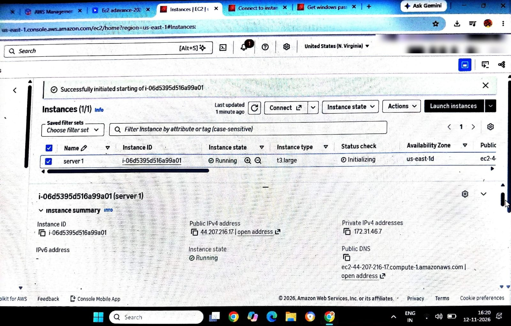
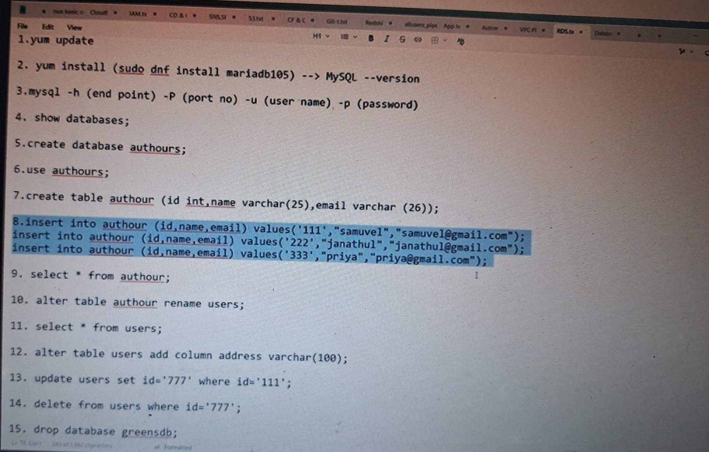
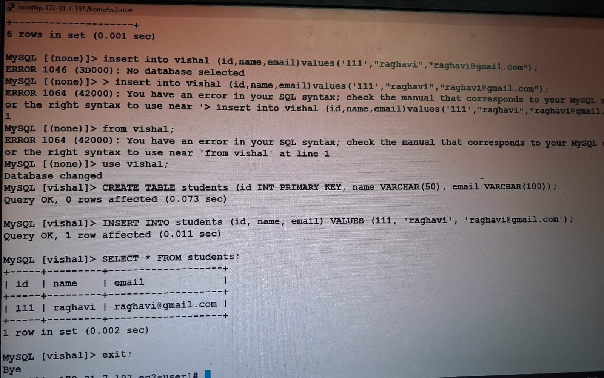

# Amazon RDS (Relational Database Service): Overview and Setup Guide

Author: Vishal, BCA graduate, learning AWS cloud

This document introduces relational databases and Amazon RDS, compares MySQL on EC2 with RDS MySQL, and outlines the steps, connection method, and good practices for running a MySQL database on RDS.

---

## 1. What is a relational database?

A relational database stores data in **tables** made of rows and columns. Tables can be linked to each other using keys, and the data is read and changed with **SQL**.

- **Table:** a collection of related records (for example, `students`)
- **Row:** one record
- **Column:** one field of the record (id, name, email)
- **Primary key:** a column that uniquely identifies each row; it cannot repeat or be empty
- **Foreign key:** a column that points to the primary key of another table

Examples of relational databases: MySQL, PostgreSQL, MariaDB, Oracle, SQL Server.

## 2. What is Amazon RDS?

Amazon RDS is a **managed** relational database service. AWS runs the database server for you and handles the routine work: setup, patching, backups, and recovery. You focus on your data and queries.

Supported engines include MySQL, PostgreSQL, MariaDB, Oracle, SQL Server, and Amazon Aurora.

## 3. MySQL on EC2 vs RDS MySQL

| | MySQL installed on EC2 | RDS MySQL |
|---|---|---|
| Setup | Install and configure it yourself | AWS sets it up |
| Backups | You create them (snapshots, mysqldump) | Automated backups |
| Updates and patches | Your responsibility | Mostly handled by AWS |
| Control | Full control of the Linux server | Limited OS access |
| Learning value | Linux and MySQL administration | Common in companies |
| Risk | Higher if backups are missed | Lower |

## 4. Key RDS concepts

- **DB instance:** the database server that RDS runs for you.
- **Instance class:** the size (CPU and memory), for example `db.t4g.micro`.
- **Storage:** disk space for the database, which can be increased later.
- **Endpoint:** the address used to connect to the database.
- **Security group:** a firewall that controls who can connect (port 3306 for MySQL).
- **DB subnet group:** the subnets in your VPC where RDS can place the database.
- **Multi-AZ:** keeps a standby copy in another Availability Zone for high availability. It costs about double.
- **Read replica:** a copy used to handle read traffic.
- **Automated backups and snapshots:** daily backups with a retention period, and manual snapshots you take yourself.

### Multi-AZ

## 5. RDS vs DynamoDB

| | RDS | DynamoDB |
|---|---|---|
| Type | Relational (SQL) | NoSQL (key-value) |
| Structure | Tables with fixed columns | Flexible items |
| Best for | Related data, complex queries | Very high traffic, simple lookups |
| Example | Customers, orders, shipments linked together | Looking up one record by its key |

## 6. Steps to create an RDS MySQL database

1. AWS Console, then **RDS**, then **Create database**.
2. Choose **Standard create** and engine **MySQL**.
3. Choose a template (Free tier or Dev/Test for practice).
4. Set the DB identifier, master username, and a strong password.
5. Choose a small instance class such as `db.t4g.micro`.
6. Set storage (20 GB is enough to start).
7. Keep **Multi-AZ off** while practicing, to save cost.
8. Choose the VPC and set **Public access** (No is safer).
9. Choose or create a **security group** allowing port 3306 only from trusted sources.
10. Click **Create database** and wait until the status is **Available**.
11. Copy the **endpoint** from the database details page.

## 7. Connecting to RDS

The EC2 server is used to connect to the private RDS database.



*Figure: EC2 instance (server 1) in the Running state. The AWS account details are blurred for privacy.*

From a Linux server (EC2) in the same VPC:

```bash
mysql -h <rds-endpoint> -u admin -p
```

A safe pattern is to keep RDS **private** (no public access) and connect through an EC2 server over SSH.

### Practice commands

The following commands were used to practice on a MySQL server running on the EC2 instance: installing the client, connecting, and creating a database, a table, and sample records.



*Figure: Command reference used for practice.*

### Practice output



*Figure: MySQL session on the EC2 server showing a database selected, a table created, a record inserted, and the result of a SELECT query. This is practice on MySQL running on EC2, not on RDS.*

## 8. Good practices

**Security**
- Keep RDS in a private subnet and do not allow public access for real data.
- Open port 3306 only to the specific security group or IP that needs it.
- Turn on **encryption at rest** and use SSL/TLS in transit.
- Use IAM with least privilege and keep the root account protected with MFA.
- Never commit passwords or access keys to GitHub.

**Backups**
- Keep automated backups enabled.
- Take a manual snapshot before big changes.
- Test a restore at least once.

**Cost**
- Start with the smallest instance and single-AZ.
- Stop or delete practice databases when not in use.
- Set a billing alarm in AWS Budgets.

## Next steps

- Launch and connect to an actual RDS MySQL instance
- Place RDS in a private subnet inside a custom VPC
- Practice restoring a database from a snapshot
- Learn SQL joins and aggregation
